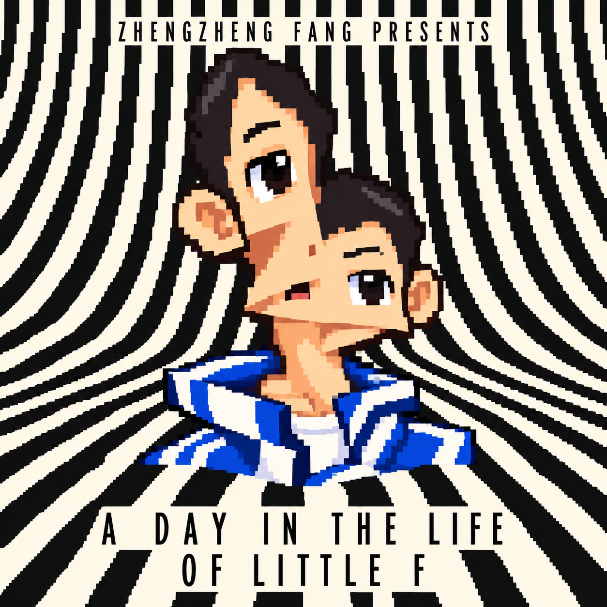

# A Day in Little F's Life

*A narrative-driven, choice-based game about surviving school, family expectations, and the consequences of everyday decisions.*

**Genre:** Interactive Fiction / Visual Novel / Life Simulation  
**Engine:** Pygame  
**Language:** English  
**Development Status:** Completed Prototype (October 2026)

---

## About the Game

**A Day in Little F's Life** is a 2D interactive narrative game developed using Python and Pygame.

The game follows Little F, a Chinese high school student who desperately wants to attend a manga signing event featuring his favourite author, Tang Jia Lao Si.

However, his mother gives him one condition: **survive an entire school week without getting her called into school again.**

What initially seems like a simple challenge gradually turns into a chaotic week filled with homework inspections, questionable friendships, school punishments, family conflicts, and unexpected moral dilemmas.

Players must manage Little F's physical and emotional well-being while making decisions that may have consequences several days later.

Will Little F finally make it to the signing event, or will his choices lead to another disastrous ending?

## Game Preview



*The game features pixel-art environments, character portraits, animated dialogue, and interactive story events.*

## Gameplay and Features

### 1. Branching Narrative

The story takes place across six in-game days, from Monday to Saturday.

Player decisions can influence later events, character relationships, and the final outcome. Some choices have immediate consequences, while others only become relevant much later in the story.

### 2. Resource Management

Players must maintain three important statistics:

| Statistic | Description |
|---|---|
| Hunger | Represents Little F's need for food and physical well-being. |
| Energy | Represents tiredness and the ability to stay awake throughout the school day. |
| Mood | Represents Little F's emotional state under social and academic pressure. |

If any statistic reaches zero, the game can trigger a corresponding bad ending.

### 3. Interactive School Events

Players encounter various events, including classroom activities, homework inspections, conversations with classmates, examinations, and after-school situations.

Choices affect both Little F's statistics and future story developments.

### 4. Character Dialogue System

The game includes:

- Animated typewriter-style dialogue
- Emotion-based character portraits
- Character-specific Animalese-style voices
- Dialogue sound effects synchronised with text
- Scene-specific visual effects and transitions

### 5. Multiple Endings

Different combinations of decisions can produce different outcomes.

Some endings are triggered by resource depletion or school disciplinary events. Others depend on choices made throughout the week.

### 6. The Final Trial

The final chapter introduces a courtroom-inspired sequence in which Little F must defend his right to attend the signing event.

Players may need to present evidence obtained earlier in the game.

The trial features dramatic visual effects, including **OBJECTION!**, **HOLD IT!**, and **TAKE THAT!**, along with an interactive evidence inventory.

## Controls

| Input | Function |
|---|---|
| Left Mouse Button | Select choices and interact with the interface |
| Space | Advance dialogue |
| F1 | Open the developer debugging menu |

The debugging menu is intended for testing and is not necessary for ordinary gameplay.

## Technologies Used

- **Python 3** — Main programming language
- **Pygame Community Edition** — Game window, rendering, input handling, and audio playback
- **NumPy** — Processing audio samples for character-specific voice effects
- **PNG Assets** — Pixel-art backgrounds, characters, and interface elements
- **OGG Audio** — Background music and character sound effects

The game uses a custom dialogue and scene-management system implemented in Python.

## Installation and Setup

### Requirements

- Python 3
- Pygame Community Edition
- NumPy

### Step 1 — Download the Project

Clone the repository:

```bash
git clone https://github.com/wanghongwen101/A-Day-in-Little-Fs-Life.git
```

Or select **Code → Download ZIP** on GitHub, then extract the downloaded archive.

### Step 2 — Install Dependencies

Open a terminal in the project folder and run:

```bash
python -m pip install pygame-ce numpy
```

### Step 3 — Run the Game

```bash
python main.py
```

**Important:** Keep `main.py` and the complete `assets` directory together. Moving or renaming resource files may prevent the game from launching.

## Project Structure

```text
A-Day-in-Little-Fs-Life/
│
├── main.py
├── README.md
│
└── assets/
    ├── cover.png
    ├── scene1.png
    ├── ...
    ├── scene30.png
    ├── portraits/
    │   ├── little_f/
    │   ├── mom/
    │   ├── dad/
    │   └── ...
    ├── voices/
    │   ├── light/
    │   ├── deep/
    │   ├── squeaky/
    │   └── ...
    └── [other UI and audio assets]
```

All visual and audio assets are loaded relative to the game's main directory.

## Creative Concept

The project explores the pressures of everyday student life through interactive storytelling and dark humour.

Rather than simply describing the expectations placed on young people, the game allows players to experience them through decisions, resource management, and narrative consequences.

The three statistics — Hunger, Energy, and Mood — reflect the tension between physical needs, emotional well-being, and academic expectations.

The final courtroom sequence transforms family authority into a literal game mechanic, bringing together the player's earlier decisions in an absurd and comedic conclusion.

## Development Process

The prototype was developed over approximately **two weeks, with around 30 hours of development work**.

Major development challenges included managing interconnected story branches, synchronising dialogue and sound effects, handling scene transitions, and ensuring decisions remained consistent across multiple in-game days.

The project also served as an opportunity to experiment with Python programming and interactive narrative design.

## Inspirations

The project draws creative inspiration from several games, including:

- *Ace Attorney* — Dramatic courtroom presentation and evidence mechanics
- *Disco Elysium* — Narrative choices and character-state systems
- *60 Seconds!* — Decision-making and resource management
- *Do Not Feed the Monkeys* — Observation, interaction, and the consequences of player decisions

These references informed the design approach, while the story focuses on an original fictionalised school-life setting.

## Project Status

**Completed — October 2026**

This repository contains the completed classroom prototype.

Future improvements could include restructuring the scene-management system, expanding player interactions, improving accessibility, and refining the balance between dialogue and gameplay.

## Credits

**Game Concept, Narrative Design, and Development:** Zhengzheng Fang

**Tools and Libraries:** Python, Pygame Community Edition, NumPy

Asset attribution and usage permissions should be documented separately where applicable.

---

*Thanks for checking out A Day in Little F's Life!*
